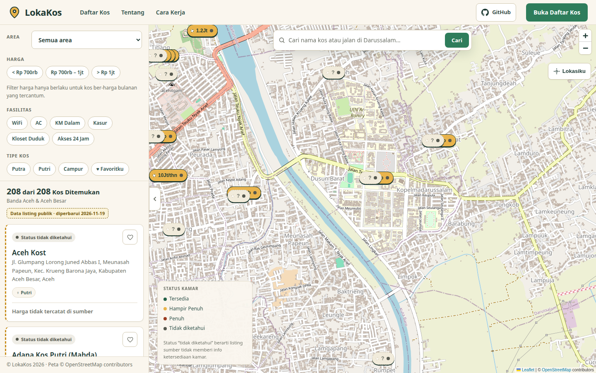

# LokaKos — Cari kos sambil lihat petanya

Marketplace kos-kosan **map-first** untuk Banda Aceh. Buka situs langsung
masuk daftar lengkap **208 kos nyata** + peta: tiap karcis kuning di peta
adalah satu kos, lengkap dengan harga mulai dan sumber listingnya.

**Live:** https://lokakos.pages.dev




> **Data listing publik, diperbarui 19 Nov 2026.** 208 kos Banda Aceh &
> Aceh Besar dari Mamikos, carialamat, penginapan.net, Instagram, airpaz,
> dan kost1 — tiap kos tertelusur ke listing aslinya (sumber + tautan +
> tanggal ambil tampil di detail tiap kos). Yang tidak ada di sumber ditulis
> tidak ada: 119 kos tanpa harga tercantum, 58 tanpa koordinat, status kamar
> semua "tidak diketahui" karena sumber tidak memberi info ketersediaan.

## Yang bisa dilakukan

- **Lihat peta + daftar lengkap** — 208 kos di Banda Aceh & Aceh Besar;
  150 berkoordinat tampil sebagai karcis harga di peta OpenStreetMap
  (Leaflet, tanpa API key). Kos tanpa harga berkarcis tanda tanya — bukan
  harga karangan. Kos tanpa koordinat tetap ada di daftar.
- **Saring yang cocok** — area, harga, fasilitas, tipe kos (putra / putri /
  campur), dan kata kunci. Daftar dan marker peta tersaring bersamaan.
  Filter harga hanya berlaku untuk harga bulanan yang tercantum.
- **Buka detail kos** — klik karcis atau kartu: harga, fasilitas, catatan
  kamar, nomor kontak publik (kalau sumber mencantumkannya), dan blok sumber
  dengan tautan listing asli.
- **Hubungi pemilik** — tombol `tel:` ke nomor publik dari listing sumber.
- **Simpan favorit** — ketuk hati; tersimpan di perangkatmu (localStorage),
  tanpa akun.
- **Bagikan tautan kos** — setiap kos punya tautan `/?kos=…`; yang menerima
  langsung melihat detail kos itu.
- **Lokasiku** — tombol di peta menerbangkan peta ke posisimu (izin browser).
- **Tentang** — halaman `/tentang` berisi perkenalan, peta live, dan contoh
  6 kos termurah.

📹 **Video demo:** [docs/demo/demo.mp4](docs/demo/demo.mp4) (5 adegan × 5 detik)

## Cara jalan

```bash
npm install
npm run dev        # http://localhost:3000
```

Tidak butuh API key, tidak butuh `.env` — peta memakai tile OpenStreetMap
gratis. (Mapbox sudah dihapus dari codebase; lihat
[docs/architecture.md](docs/architecture.md) untuk alasannya.)

```bash
npm run build      # static export -> out/ (yang di-deploy ke Cloudflare Pages)
npm test           # Playwright e2e (butuh server di :8331, lihat docs/testing.md)
npm run validate   # tautan + secret + gate anti-slop P0 + Mapbox bersih
npm run sweep      # advisory-sweep OSV (produksi saja)
npm run screenshots # docs/screenshots/*.png
npm run make-video  # docs/demo/demo.mp4
```

Butuh Node ≥ 22.

## Dataset

`data/kos.json` — 208 kos (lihat [docs/data.md](docs/data.md) untuk sumber,
cara kumpul, skema, dan batasan). Mentah + skrip pengumpulan di
`scripts/collect/` (`raw-batch-*.json`, `merge.py`, `geocode.py`) supaya
dataset bisa diulang dan di-refresh. Aturan keras: tanpa Google Maps, tanpa
scrape massal, tanpa fabrikasi, tanpa nomor relay platform sebagai kontak,
foto hanya hotlink URL sumber.

## Tech stack

Next.js 16 (App Router, static export) · React 19 · TypeScript · Tailwind v4 ·
Leaflet + react-leaflet (tile OpenStreetMap) · Playwright.

## Struktur

```
src/app/            # / (explorer penuh) · /tentang (landing) · /peta (redirect ke /)
src/components/     # layout (Navbar, FilterPanel) · map (MapView, MapContainer, MapSearchBar)
                    # property (PropertyCard, PropertyDetail, PropertyList)
src/lib/            # kosData (dataset 208 kos) · format · filter · favorites · property · map/config
data/kos.json       # dataset final (208 kos)
scripts/collect/    # raw-batch-*.json + merge.py + geocode.py (cara kumpul dataset)
docs/               # DESIGN.md · architecture.md · data.md · deploy.md · testing.md
                    # diagrams.html · screenshots/ · demo/ · proposals/
```

## Dokumentasi

- [PRD](PRD.md) — kebutuhan produk
- [docs/DESIGN.md](docs/DESIGN.md) — kontrak arah desain (referensi: Marren & Co, Framer)
- [docs/architecture.md](docs/architecture.md) — arsitektur + keputusan teknis
- [docs/data.md](docs/data.md) — dataset jujur + aturan filter
- [docs/deploy.md](docs/deploy.md) — deploy Cloudflare Pages
- [docs/testing.md](docs/testing.md) — cara tes + play-test manual
- [docs/diagrams.html](docs/diagrams.html) — diagram arsitektur + alur pengguna
- [docs/PLANNER.md](docs/PLANNER.md) — arsip memory bank MVP awal

## Lisensi

MIT — lihat [LICENSE](./LICENSE).

---
_Dikembangkan oleh **dezzorigin** (Nabil Aulia Dika)._
