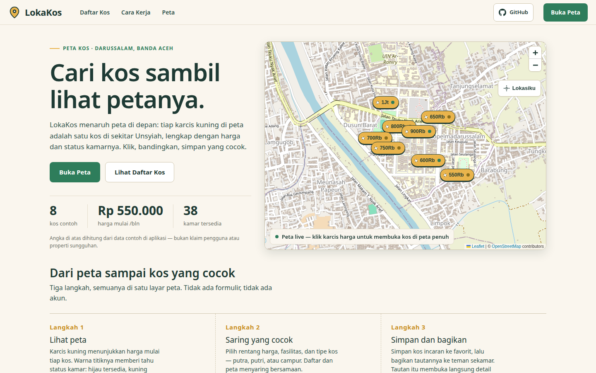
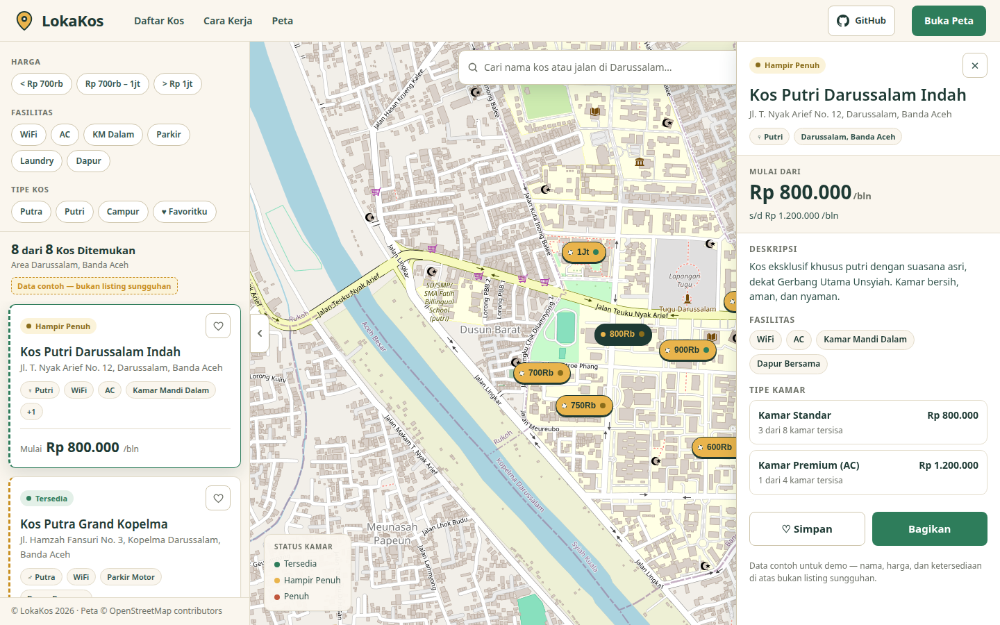

# LokaKos — Cari kos sambil lihat petanya

Marketplace kos-kosan **map-first** untuk Darussalam / Kopelma, Banda Aceh
(sekitar Unsyiah). Peta di depan, daftar di samping: tiap karcis kuning di
peta adalah satu kos, lengkap dengan harga mulai dan status kamarnya.

**Live:** https://lokakos.pages.dev




> **Data contoh.** Semua kos di situs ini adalah data contoh untuk demo —
> nama, harga, dan ketersediaan kamar bukan listing sungguhan.

## Yang bisa dilakukan

- **Lihat peta** — 8 kos contoh di sekitar Unsyiah sebagai karcis harga di
  peta OpenStreetMap (Leaflet, tanpa API key). Warna titik = status kamar:
  hijau tersedia, kuning hampir penuh, merah penuh.
- **Saring yang cocok** — harga, fasilitas, tipe kos (putra / putri / campur),
  dan kata kunci. Daftar dan marker peta tersaring bersamaan.
- **Buka detail kos** — klik karcis atau kartu: deskripsi, fasilitas, tipe
  kamar + sisa kamar, harga per bulan.
- **Simpan favorit** — ketuk hati; tersimpan di perangkatmu (localStorage),
  tanpa akun.
- **Bagikan tautan kos** — setiap kos punya tautan `/peta?kos=…`; yang
  menerima langsung melihat detail kos itu.
- **Lokasiku** — tombol di peta menerbangkan peta ke posisimu (izin browser).

📹 **Video demo:** [docs/demo/demo.mp4](docs/demo/demo.mp4) (5 adegan × 5 detik)

## Cara jalan

```bash
npm install
npm run dev        # http://localhost:3000
```

Tidak butuh API key, tidak butuh `.env` — peta memakai tile OpenStreetMap
gratis. (Mapbox sudah dihapus dari codebase; lihat
[docs/architecture.md](docs/architecture.md) untuk alasannya.)

```bash
npm run build      # static export -> out/ (yang di-deploy ke Cloudflare Pages)
npm test           # Playwright e2e (butuh server di :8331, lihat docs/testing.md)
npm run validate   # tautan + secret + gate anti-slop P0 + Mapbox bersih
npm run sweep      # advisory-sweep OSV (produksi saja)
npm run screenshots # docs/screenshots/*.png
npm run make-video  # docs/demo/demo.mp4
```

Butuh Node ≥ 22.

## Tech stack

Next.js 16 (App Router, static export) · React 19 · TypeScript · Tailwind v4 ·
Leaflet + react-leaflet (tile OpenStreetMap) · Playwright.

## Struktur

```
src/app/            # / (landing) · /peta (aplikasi penuh) · not-found
src/components/     # layout (Navbar, FilterPanel) · map (MapView, MapContainer, MapSearchBar)
                    # property (PropertyCard, PropertyDetail, PropertyList)
src/lib/            # mockData (8 kos contoh) · filter · favorites · property · map/config
docs/               # DESIGN.md · architecture.md · data.md · deploy.md · testing.md
                    # diagrams.html · screenshots/ · demo/ · proposals/
```

## Dokumentasi

- [PRD](PRD.md) — kebutuhan produk
- [docs/DESIGN.md](docs/DESIGN.md) — kontrak arah desain (referensi: Marren & Co, Framer)
- [docs/architecture.md](docs/architecture.md) — arsitektur + keputusan teknis
- [docs/data.md](docs/data.md) — data contoh + aturan filter
- [docs/deploy.md](docs/deploy.md) — deploy Cloudflare Pages
- [docs/testing.md](docs/testing.md) — cara tes + play-test manual
- [docs/diagrams.html](docs/diagrams.html) — diagram arsitektur + alur pengguna
- [docs/PLANNER.md](docs/PLANNER.md) — arsip memory bank MVP awal

## Lisensi

MIT — lihat [LICENSE](./LICENSE).

---
_Dikembangkan oleh **dezzorigin** (Nabil Aulia Dika)._
